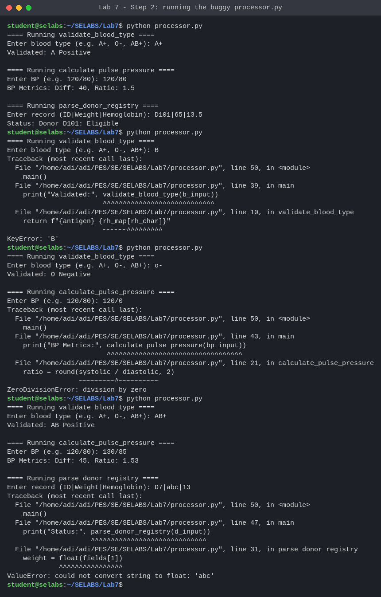
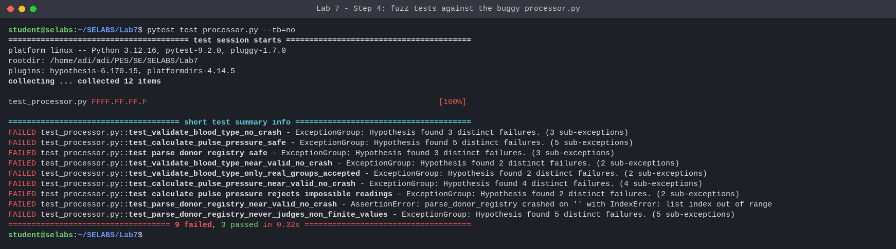
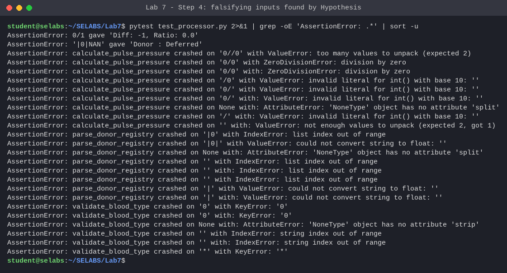
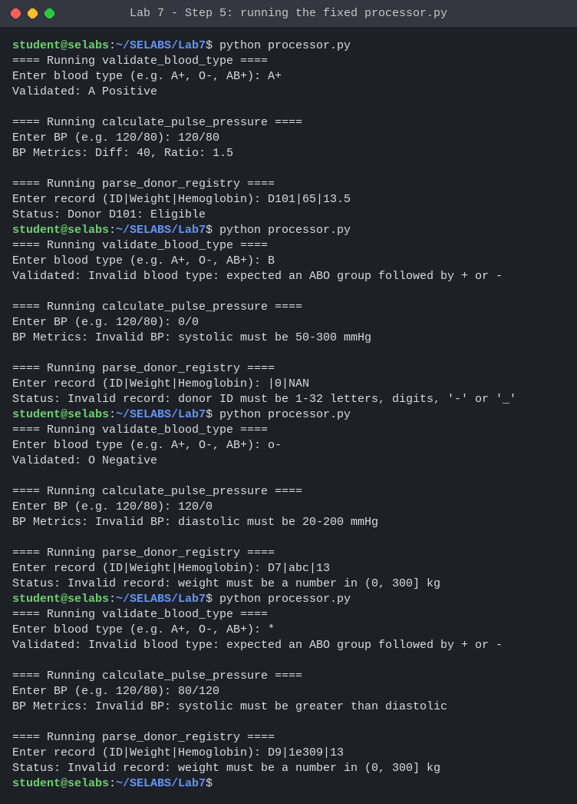
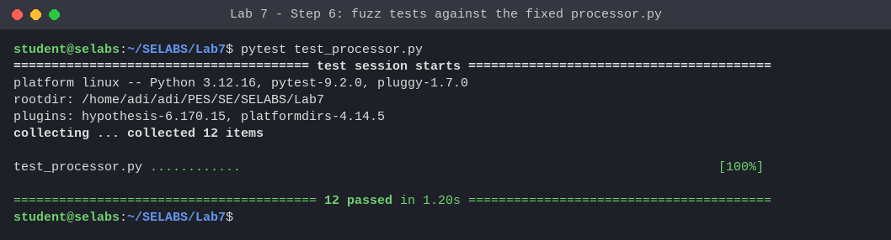

# Lab 7 – Fuzzing for Input Validation Bugs

**Name:** Aditya Pradeep  **SRN:** PES2UG24AM900  **Section:** 5B
**Assigned repo:** `SETAPESU26/L6_L7_05_blood_donation_screening` (Lab 7) · **Tool:** Hypothesis 6.170 + pytest 9.2 (Python 3.12)

## Step 1 – Install dependencies

`pip install hypothesis` and `pip install pytest`

## Step 2 – Run the buggy `processor.py`

With valid input the program works. Three ordinary typos each crash it with a different unhandled exception: `B` raises **KeyError**, `120/0` raises **ZeroDivisionError**, and `D7|abc|13` raises **ValueError**.

## Step 3 – Complete `test_processor.py` using Hypothesis

* **The three starter tests** (`test_validate_blood_type_no_crash`, `test_calculate_pulse_pressure_safe`, `test_parse_donor_registry_safe`) were completed with `try/except`. Each feeds `st.text() | st.none()` into a function. If the function raises, the test fails with `assert False, "<function> crashed on <input> with <error>"`. It also checks that a string is returned.
* **Targeted strategies** (`blood_like`, `bp_like`, `record_like`) generate inputs that *almost* match the expected format, such as `0/0`, `120//80`, `O`, `*`, `|0|NAN` and `D1|1e309|13`. Purely random text rarely contains `/` or `|`, so these reach much deeper into the parsing code.
* **Correctness properties:**
  * Every real blood code (in any case, with padding) is standardised correctly, and the output is always one of the 8 real groups or an "Invalid" message.
  * For valid BP readings the pulse difference and ratio are computed correctly, and impossible readings (≤ 0, or systolic ≤ diastolic) are rejected.
  * Valid donor records get the right Eligible/Deferred decision, and NaN or infinite values are never judged.

## Step 4 – Run `test_processor.py` against the buggy code: 9 failed, 3 passed

Falsifying inputs that Hypothesis found and minimised (extracted from the full output; see `screenshots/step4_full_pytest_output.txt`):

| Function | Inputs found by Hypothesis | Failure |
|----------|---------------------------|---------|
| `validate_blood_type` | `None` | AttributeError (`None.strip`) |
| | `''` | IndexError (`cleaned[-1]`) |
| | `'0'`, `'*'` | KeyError (`rh_map[rh_char]`) |
| | `'X+'` *(checked by hand)* | Wrong answer: `'X Positive'`. An unknown ABO group was accepted. In this run the crashes above hid it from the `only_real_groups` property. |
| `calculate_pulse_pressure` | `None` | AttributeError |
| | `''`, `'0//0'` | ValueError (tuple unpacking) |
| | `'/'`, `'/0'`, `'0/'` | ValueError (`int('')`) |
| | `'0/0'` | ZeroDivisionError |
| | `'0/1'` | Wrong answer: `Diff: -1, Ratio: 0.0` |
| `parse_donor_registry` | `None` | AttributeError |
| | `''`, `'|0'` | IndexError (`fields[1]`, `fields[2]`) |
| | `'|'`, `'|0|'` | ValueError (`float('')`) |
| | `'|0|NAN'` | Wrong answer: a NaN value was judged "Deferred", with an empty donor ID |

## Step 5 – Fix `processor.py` and run it

Each function now validates its input and returns a descriptive **"Invalid …" message** instead of raising:

* **Type check first:** `None` and other non-string inputs are rejected.
* **Structural check:** a blood code must have at least 2 characters, a BP reading exactly one `/`, and a donor record exactly three `|`-separated fields.
* **Value check:**
  * ABO group must be in {A, B, AB, O} and Rh must be `+` or `-`.
  * BP values must be ASCII whole numbers within physiological ranges (systolic 50–300, diastolic 20–200 mmHg) with systolic > diastolic. This makes division by zero impossible.
  * Weight and hemoglobin must be finite floats in range (`math.isfinite` rejects `nan`, `inf` and `1e309`), and the donor ID must match `[A-Za-z0-9_-]{1,32}`.
* `main()` exits cleanly on EOF or Ctrl-C.

Running it with the same inputs as Step 2, plus the inputs the fuzzer found:

## Step 6 – Re-run `test_processor.py` against the fixed code: 12 passed

As an extra check, each fixed function was also fuzzed with **20,000 examples** of arbitrary types (None, text, ints, floats, bytes, lists). None of them raised an exception.

## Deliverables

| # | Deliverable | File |
|---|-------------|------|
| 1 | PDF document with the screenshots | `Lab7_Fuzz_Testing_Report.pdf` (this file) |
| 2 | Fixed application Python script | `processor.py` |
| 3 | Updated test file | `test_processor.py` |
